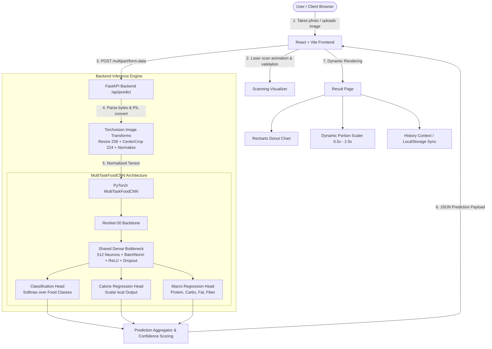
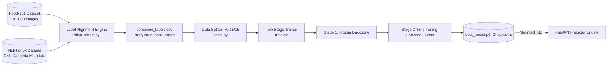

# 🥗 NutriVision AI – Comprehensive Project Documentation

> **AI-Powered Food Image Identification, Calorie Estimation & Macronutrient Regression System**  
> *Author / Developer: Karan Vishwajyoth*  
> *Last Updated: October 2026*

---

## 📋 Table of Contents
1. [Project Overview & Vision](#1-project-overview--vision)
2. [Current Completion Status (Where the Project Stands)](#2-current-completion-status-where-the-project-stands)
3. [Technology Stack](#3-technology-stack)
4. [System Architecture & Data Flow](#4-system-architecture--data-flow)
5. [Complete Directory & File Structure](#5-complete-directory--file-structure)
6. [Core Features & User Experience](#6-core-features--user-experience)
7. [Machine Learning Pipeline Details](#7-machine-learning-pipeline-details)
8. [Backend API Specification](#8-backend-api-specification)
9. [How to Run & Deploy](#9-how-to-run--deploy)
10. [Roadmap & Future Enhancements](#10-roadmap--future-enhancements)

---

## 1. Project Overview & Vision

**NutriVision AI** is an end-to-end artificial intelligence application designed to automate dietary logging and nutritional tracking from raw food photographs. By combining computer vision with multi-task deep convolutional neural networks (CNNs), the application enables users to snap or upload a photo of any dish and instantly receive:

- **Food Category Classification**: Recognizes the dish among 101 distinct culinary categories.
- **Continuous Calorie Regression**: Accurately estimates energy content in kilocalories (`kcal`).
- **Macronutrient Breakdown**: Simultaneously predicts core macronutrients—**Protein (g)**, **Carbohydrates (g)**, **Fat (g)**, and **Fiber (g)**.
- **Portion Dynamics**: Real-time multiplier scaling (`0.5x`, `1.0x`, `1.5x`, `2.0x`) with dynamic recalculation of Daily Value percentages (`% DV`).
- **Health Insights & Quality Guardrails**: Detects ambiguous or low-confidence captures (`< 65%`) and provides practical photographic feedback.

The repository is structured into two complementary ecosystems:
1. **Full-Stack Application Layer**: A responsive modern React frontend coupled with an asynchronous Python FastAPI backend, fully containerized with Docker.
2. **Machine Learning Pipeline Layer**: An end-to-end dataset preparation, label alignment (Food-101 + Nutrition5k), multi-task training, loss weight sweeping, and checkpoint evaluation suite.

---

## 2. Current Completion Status (Where the Project Stands)

Here is an honest, granular audit of the implementation status across all subsystems:

| Subsystem | Component | Status | Details |
| :--- | :--- | :---: | :--- |
| **Frontend** | Landing Page (`Home.jsx`) | **100% Complete** | Hero section, feature showcases, workflow steps, interactive tech stack showcase, responsive navigation. |
| **Frontend** | Authentication (`AuthContext`, `Login`, `Signup`) | **100% Complete** | Live backend JWT integration + 1-click **Demo Account Mode** with token interceptors and local storage state persistence. |
| **Frontend** | Dashboard (`Dashboard.jsx`, `QuickStats.jsx`) | **100% Complete** | Personalized metrics, 4 top stat cards, daily calorie & protein progress bars, quick scan access. |
| **Frontend** | Food Scanner UI (`FoodUploader.jsx`, `ScanningOverlay.jsx`) | **100% Complete** | Drag-and-drop zone, camera upload trigger, image format/size validation, animated neon laser scanning beam. |
| **Frontend** | Analysis Breakdown (`Result.jsx`, `NutritionChart.jsx`) | **100% Complete** | Interactive Recharts donut chart for macro energy contribution, dynamic portion scaler slider, confetti on high confidence, JSON export, clipboard copy (Hook order audited). |
| **Frontend** | Scan History (`History.jsx`, `HistoryContext.jsx`) | **100% Complete** | Grid/table views, live search, macro filter chips (High Protein, Low Calorie, etc.), sorting, modal drill-down, deletion, LocalStorage + backend sync. |
| **Frontend** | Profile & Goals (`Profile.jsx`) | **100% Complete** | Custom daily targets (Calories, Protein), dietary preference selector, password change, account summary with backend persistence. |
| **Backend API** | FastAPI Service (`backend/app/main.py`) | **100% Complete** | Endpoints for `/api/health`, `/api/predict`, `/api/auth/*` (register, login, me, profile), and `/api/history` (GET, POST, DELETE), CORS enabled. |
| **Backend API** | Database Layer (`backend/app/database.py`) | **100% Complete** | SQLite persistence layer with transactions, indexed tables for users and scan history, and zero-config deployment. |
| **Backend API** | Real Authentication (`backend/app/auth.py`) | **100% Complete** | PBKDF2-HMAC-SHA256 password hashing (100,000 rounds) + RFC 7519 HMAC-SHA256 JWT tokens with bearer auth dependencies. |
| **Backend API** | Schemas & Contracts (`schemas.py`) | **100% Complete** | Strict Pydantic v2 validation models for requests, auth payloads, health status, and full nutritional predictions. |
| **Backend API** | Integration Tests (`backend/tests/test_api.py`) | **100% Complete** | Comprehensive test suite covering health check, registration, duplicate checks, login, JWT token verification, history CRUD, and image validation. |
| **Backend API** | Inference Runner (`predictor.py`) | **100% Complete** | Torchvision pipeline transforms, tensor conversion, batching, inference timing, and safety error checks. |
| **Backend API** | Neural Architecture (`model.py`) | **100% Complete** | `MultiTaskFoodCNN` with ResNet-50 backbone, shared latent bottleneck, classification head + dual continuous regression heads. |
| **DevOps** | Containerization (`Dockerfile`, `docker-compose.yml`) | **100% Complete** | Multi-container setup orchestrating frontend (Nginx SPA) and backend (FastAPI Uvicorn) with one command. |
| **ML Pipeline** | Data Ingestion (`download_food101.py`, `prepare_nutrition5k.py`) | **100% Complete** | Automated downloaders and formatters for Food-101 and Nutrition5k cafeteria datasets. |
| **ML Pipeline** | Label Alignment (`align_labels.py`) | **100% Complete** | Fuzzy string matching with SequenceMatcher, threshold tuning, and manual overrides YAML. |
| **ML Pipeline** | Splits & Dataset (`splits.py`, `food_dataset.py`) | **100% Complete** | Stratified split manifest generator (70/15/15), PyTorch `Dataset` with official Food-101 partitions. |
| **ML Pipeline** | Multi-Task Training (`train.py`, `losses.py`) | **100% Complete** | Two-stage training regime (frozen feature extraction followed by partial backbone unfreezing), AMP mixed precision, checkpointing. |
| **ML Pipeline** | Evaluation Suite (`ml/evaluation/evaluate.py`) | **100% Complete** | Computes Top-1/Top-5 accuracy, macro F1, MAE, RMSE, Pearson $r$, $R^2$ score per nutrient, with automated JSON & Markdown export. |
| **ML Pipeline** | Quantization & Optimization (`ml/inference/export_and_quantize.py`) | **100% Complete** | Dynamic INT8 quantization, TorchScript tracing, ONNX export, and CPU latency benchmarking. |
| **ML Pipeline** | Hyperparameter Sweeps (`sweep_loss_weights.py`) | **100% Complete** | Grid search over $\lambda_{\text{cls}}$ and $\lambda_{\text{reg}}$ balancing classification accuracy vs regression MAE. |
| **ML Pipeline** | Jupyter Notebooks (`ml/notebooks/`) | **100% Complete** | 4 structured notebooks: environment check, data exploration, pipeline sanity checks, and loss weight analysis. |
| **ML Pipeline** | Automated Unit Tests (`ml/tests/`) | **100% Complete** | Pytest suites verifying tensor shapes, losses, metrics, evaluation pipeline, and inference quantization. |
| **Model Weights** | Trained `.pth` Checkpoint | **Pending Run** | Pipeline is ready; weights need to be trained via Google Colab T4 GPU (using `ml/training/RUN_INSTRUCTIONS.md`) and placed into backend. |

---

## 3. Technology Stack

### 💻 Frontend Architecture
- **Core Library**: [React 19](https://react.dev/) (Functional components, hooks, custom context)
- **Build Tool & Bundler**: [Vite 8](https://vitejs.dev/) (Lightning-fast HMR and ESM bundling)
- **Styling**: [Tailwind CSS v3.4](https://tailwindcss.com/) with custom typography, brand palette, and soft drop shadows
- **Routing**: [React Router v7](https://reactrouter.com/) (Declarative client-side routing with `ProtectedRoute` guards)
- **Data Visualization**: [Recharts v3](https://recharts.org/) (Interactive SVG Donut chart displaying caloric share of macros)
- **Icons & UI FX**: [Lucide React](https://lucide.dev/) (Feather icon set) + [Canvas Confetti](https://www.npmjs.com/package/canvas-confetti)
- **HTTP Client**: [Axios](https://axios-http.com/) with configured timeouts, interceptors, and error handling
- **Code Quality**: [Oxlint](https://oxc-project.github.io/)

### ⚙️ Backend API
- **Framework**: [FastAPI 0.115](https://fastapi.tiangolo.com/) (High-performance ASGI Python framework)
- **Server**: [Uvicorn 0.34](https://www.uvicorn.org/) (Standard async worker)
- **Data Modeling & Validation**: [Pydantic v2](https://docs.pydantic.dev/)
- **Image Processing**: [Pillow 11 (PIL)](https://python-pillow.org/)
- **File Upload Handling**: `python-multipart`

### 🧠 Deep Learning & Machine Learning
- **Framework**: [PyTorch 2.6](https://pytorch.org/) & [Torchvision 0.21](https://pytorch.org/vision/)
- **Backbone CNNs**: ResNet-50 (`torchvision.models.resnet50`) and EfficientNet-B0
- **Multi-Task Heads**:
  - Head 1: Food Classification (101-class CrossEntropyLogits)
  - Head 2: Caloric Regression (Single continuous scalar $\text{kcal}$)
  - Head 3: Macronutrient Regression (4-dimensional vector: $[\text{protein}, \text{carbs}, \text{fat}, \text{fiber}]$)
- **Data & Metrics**: Pandas, NumPy, Scikit-Learn, PyYAML, Tqdm, Matplotlib
- **Testing**: Pytest

### 🐳 DevOps & Deployment
- **Docker**: Independent multi-stage Dockerfiles for frontend (Node build + Nginx Alpine) and backend (Python 3.11 slim)
- **Docker Compose**: Single-command multi-container orchestration (`docker-compose.yml`)

---

## 4. System Architecture & Data Flow

### Application Workflow



### ML Pipeline Data Flow



---

## 5. Complete Directory & File Structure

Below is the complete tree of the workspace with annotations for every file and folder:

```text
c:\Users\KARAN\Food Image Calorie Estimator\
│
├── .git/                                 # Git version control metadata
├── .venv/                                # Local Python virtual environment
├── docker-compose.yml                    # Multi-container orchestration (Frontend + Backend)
├── README.md                             # High-level repository summary & quick start
├── PROJECT_DOCUMENTATION.md              # Complete exhaustive project documentation (This file)
│
├── backend/                              # FastAPI Python Backend
│   ├── Dockerfile                        # Python 3.11 container definition
│   ├── requirements.txt                  # Backend Python dependencies
│   ├── app/                              # Application source code
│   │   ├── __init__.py                   # Package initializer
│   │   ├── main.py                       # FastAPI application setup, CORS, and REST route handlers
│   │   ├── model.py                      # MultiTaskFoodCNN PyTorch model architecture
│   │   ├── predictor.py                  # Image loader, transforms, and inference execution engine
│   │   ├── database.py                   # SQLite persistence layer for users and scan history
│   │   ├── auth.py                       # PBKDF2 password hashing & RFC 7519 JWT auth handling
│   │   └── schemas.py                    # Pydantic data validation contracts (Prediction, Auth, History)
│   └── tests/                            # API integration tests
│       └── test_api.py                   # Automated tests for Health, Auth, History CRUD & validation
│
├── frontend/                             # React + Vite Single Page Web Application
│   ├── index.html                        # SPA HTML root entry point with Google Fonts
│   ├── package.json                      # Frontend dependencies, scripts, and build configurations
│   ├── package-lock.json                 # Pinned dependency lockfile
│   ├── vite.config.js                    # Vite bundler configuration with React plugin
│   ├── tailwind.config.js                # Custom Tailwind design system tokens, colors & shadows
│   ├── postcss.config.js                 # PostCSS autoprefixer configuration
│   ├── nginx.conf                        # Production Nginx reverse-proxy and client-routing configuration
│   ├── Dockerfile                        # Multi-stage production container build (Vite -> Nginx)
│   ├── .oxlintrc.json                    # Oxlint static analysis rules
│   ├── .gitignore                        # Frontend build output exclusions
│   ├── public/                           # Static public assets (Favicon, icons)
│   └── src/
│       ├── main.jsx                      # React application bootstrap entry
│       ├── App.jsx                       # Declarative route configuration and ProtectedRoute logic
│       ├── index.css                     # Global Tailwind directives and base typography
│       ├── App.css                       # Custom animations and laser scan keyframes
│       │
│       ├── components/                   # Modular UI components
│       │   ├── Navbar.jsx                # Global navigation bar with responsive mobile menu
│       │   ├── Sidebar.jsx               # Dashboard sidebar navigation with user badge & route links
│       │   ├── DashboardHeader.jsx       # Dynamic greetings, breadcrumbs, and quick action buttons
│       │   ├── QuickStats.jsx            # 4 metric cards (Total Scans, Calories, Protein, Week Count)
│       │   ├── FoodUploader.jsx          # File dropzone, camera trigger, file validation & preview
│       │   ├── ScanningOverlay.jsx       # Futuristic scanning beam animation over food photos
│       │   ├── NutritionCard.jsx         # Card displaying nutrient weight, % Daily Value, and progress bar
│       │   ├── NutritionChart.jsx        # Donut chart rendering macro caloric percentage distribution
│       │   ├── ConfidenceBadge.jsx       # Color-coded pill reflecting AI confidence score
│       │   ├── LowConfidenceAlert.jsx    # Warning card triggered when prediction confidence < 65%
│       │   ├── LoadingState.jsx          # Engaging multi-step loader during AI inference
│       │   ├── DisclaimerBanner.jsx      # FDA/medical disclaimer on AI nutritional approximations
│       │   └── Toast.jsx                 # Dynamic floating notification alerts
│       │
│       ├── context/                      # Global state management via React Context
│       │   ├── AuthContext.jsx           # User authentication, demo session, and profile updater
│       │   └── HistoryContext.jsx        # Scan history state, LocalStorage sync, and analytics aggregator
│       │
│       ├── pages/                        # Route page views
│       │   ├── Home.jsx                  # Marketing landing page with hero, tech stack, and workflow
│       │   ├── Login.jsx                 # Login form with 1-click Demo Account login
│       │   ├── Signup.jsx                # Account creation form with validation
│       │   ├── Dashboard.jsx             # User home showing quick stats, scanner, and recent scans
│       │   ├── Analyze.jsx               # Full-screen scanning workstation with tips & guidance
│       │   ├── Result.jsx                # Rich results breakdown, portion scaler, copy & JSON export
│       │   ├── History.jsx               # Searchable, filterable, sortable history catalog
│       │   └── Profile.jsx               # Account settings, calorie & protein goals, password update
│       │
│       └── services/
│           └── api.js                    # Axios client abstraction with endpoints and error fallbacks
│
└── ml/                                   # Machine Learning Research & Training Pipeline
    ├── requirements.txt                  # Python training dependencies (PyTorch 2.6, Torchvision, etc.)
    │
    ├── configs/
    │   └── base.yaml                     # Central YAML config (Data paths, hyperparams, training stages)
    │
    ├── data/
    │   ├── download_food101.py           # Automated downloader & extractor for Food-101
    │   ├── prepare_nutrition5k.py        # Nutrition5k metadata parser & CSV clean-up
    │   ├── align_labels.py               # Fuzzy text matcher aligning Food-101 to Nutrition5k targets
    │   ├── splits.py                     # Deterministic stratified 70/15/15 train/val/test splitter
    │   ├── food_dataset.py               # PyTorch Food101NutritionDataset implementation
    │   ├── manual_overrides.yaml         # Manual text overrides for edge-case food dish matches
    │   └── DATA_AUDIT.md                 # Quality audit notes, outlier documentation & assumptions
    │
    ├── models/
    │   ├── multitask_cnn.py              # ResNet-50 / EfficientNet-B0 multi-task architecture
    │   └── checkpoint.py                 # Safe checkpoint saving/loading utilities
    │
    ├── preprocessing/
    │   └── transforms.py                 # Torchvision data augmentation & normalization pipelines
    │
    ├── training/
    │   ├── train.py                      # Two-stage multi-task training loop with AMP support
    │   ├── losses.py                     # MultiTaskLoss balancing classification and regression
    │   ├── sweep_loss_weights.py         # Grid search script evaluating candidate loss weight pairs
    │   ├── compare_runs.py               # Comparative metrics table generator for training sweeps
    │   └── RUN_INSTRUCTIONS.md           # Step-by-step Google Colab T4 GPU execution guide
    │
    ├── evaluation/                       # Model evaluation & benchmarking
    │   └── evaluate.py                   # Test split evaluation (Top-1/5, F1, MAE, RMSE, Pearson r, R2)
    │
    ├── inference/                        # Post-training optimization & runtime deployment
    │   └── export_and_quantize.py        # INT8 dynamic quantization, TorchScript & ONNX export
    │
    ├── notebooks/                        # Interactive Jupyter experimentation notebooks
    │   ├── 00_environment_check.ipynb    # Validates GPU accelerator, CUDA drivers, and libraries
    │   ├── 01_data_exploration.ipynb     # Dataset inspection, class distribution & outlier analysis
    │   ├── 02_pipeline_sanity_check.ipynb# Overfitting test on tiny batch to verify loss convergence
    │   └── 03_loss_weight_analysis.ipynb # Interactive sweep plots for lambda_cls vs lambda_reg
    │
    └── tests/                            # Automated Pytest suite for ML modules
        ├── test_model_shapes.py          # Verifies output tensor dimensions for backbones
        ├── test_losses.py                # Tests multi-task loss calculation and weighting
        ├── test_train_metrics.py         # Tests accuracy, MAE, and evaluation metric functions
        ├── test_evaluation.py            # Tests classification & regression evaluation calculations
        └── test_inference_optimization.py# Tests INT8 quantization and TorchScript tracing

```

---

## 6. Core Features & User Experience

### 1. Futuristic AI Laser Scanning
When a user uploads or snaps an image of their meal, the `ScanningOverlay` component overlays a neon holographic reticle, corner target markers, and an animated scanning laser beam that moves vertically across the photo to simulate real-time visual neural processing.

### 2. Multi-Task Nutrition Predictions
Rather than estimating calories from generic lookup tables, the model simultaneously outputs:
- **Food Class**: Identified dish name and category.
- **Calories**: Continuous predicted energy value.
- **Macronutrients**: Protein, Carbohydrates, Fat, and Dietary Fiber in grams.
- **Confidence Metric**: Confidence score expressed as a percentage, visually highlighted with color-coded badges (`Emerald` for high, `Amber` for moderate, `Rose` for low).

### 3. Dynamic Portion Scaler
Meals are rarely standard 100g portions. The Result view includes an interactive portion multiplier:
- Users select `0.5x (Half)`, `1.0x (Standard)`, `1.5x (Large)`, or `2.0x (Double)`.
- All calorie numbers, macro grams, and daily recommended values (`% DV`) recalculate dynamically on screen in real time.

### 4. Interactive Caloric Share Donut Chart
Built using Recharts, the chart calculates the caloric contribution of each macronutrient:
$$\text{Caloric Contribution} = (\text{Protein} \times 4) + (\text{Carbs} \times 4) + (\text{Fat} \times 9)$$
Displays interactive hover tooltips with exact gram counts and percentage shares.

### 5. Low-Confidence Safeguards
If the image is blurry, poorly lit, or depicts an unrecognized dish (confidence $< 65\%$), the system displays a prominent `LowConfidenceAlert` banner with actionable advice:
- Ensure adequate lighting.
- Keep the plate centered in frame.
- Avoid blurry overhead angles.

### 6. Scan History & Search Workstation
- Preserves every analysis in both `LocalStorage` and the FastAPI backend memory.
- Allows switching between **Grid View** (visual cards) and **Table View** (dense list).
- Live search by dish name or dietary tag.
- Category filters: *All Dishes*, *High Protein ($\ge 25\text{g}$)*, *Low Calorie ($\le 450\text{ kcal}$)*, *High Calorie ($\ge 650\text{ kcal}$)*.
- Sorting by date, calories (ascending/descending), or protein.
- Detail preview modal and instant item deletion.

### 7. Nutrition Goals & Streak Tracking
- Users set custom daily targets in `Profile.jsx` (e.g., 2,200 kcal, 130g protein).
- QuickStats automatically aggregates the user's logged intake for the current day and compares it against their personalized targets.

---

## 7. Machine Learning Pipeline Details

### Problem Formulation
Food calorie estimation is framed as a **Multi-Task Supervised Learning** problem. Given an RGB food image $x \in \mathbb{R}^{3 \times 224 \times 224}$, the network predicts:
1. Classification logits: $\hat{y}_{\text{cls}} \in \mathbb{R}^{C}$ (where $C = 101$).
2. Nutrition targets: $\hat{y}_{\text{nutr}} \in \mathbb{R}^{4}$ representing $[\text{calories}, \text{protein}, \text{carbs}, \text{fat}]$.

### Multi-Task Loss Objective
The composite loss function balances classification error with continuous regression error:
$$\mathcal{L}_{\text{total}} = \lambda_{\text{cls}} \mathcal{L}_{\text{cls}}(\hat{y}_{\text{cls}}, y_{\text{cls}}) + \lambda_{\text{reg}} \mathcal{L}_{\text{reg}}(\hat{y}_{\text{nutr}}, y_{\text{nutr}})$$
Where:
- $\mathcal{L}_{\text{cls}}$ is Cross-Entropy Loss with optional label smoothing.
- $\mathcal{L}_{\text{reg}}$ is Smooth L1 Loss (Huber Loss) to remain robust against outlier nutrition values.
- $\lambda_{\text{cls}}$ and $\lambda_{\text{reg}}$ are hyperparameters tuned via `sweep_loss_weights.py`.

### Two-Stage Training Regime (`train.py`)
To prevent the random initialization of the regression and classification heads from destroying pretrained ImageNet weights:
1. **Stage 1 (Feature Extraction)**: The ResNet-50 backbone is completely frozen (`requires_grad = False`). Only the shared dense layer and the task heads are trained for 2 epochs with learning rate $\eta = 10^{-3}$.
2. **Stage 2 (Fine-Tuning)**: The top residual block of the backbone is unfrozen. The entire model is fine-tuned for 8 epochs with a reduced learning rate $\eta = 10^{-4}$ and automatic mixed precision (`torch.cuda.amp.autocast`).

---

## 8. Backend API Specification

The FastAPI backend runs on port `8000` by default. Interactive OpenAPI Swagger documentation is available at `http://localhost:8000/docs`.

### Key Endpoints

#### 1. System Health Check
- **Route**: `GET /api/health`
- **Description**: Returns operational status, loaded device (CPU/CUDA), and model status.
- **Response**:
```json
{
  "status": "healthy",
  "modelLoaded": true,
  "modelArchitecture": "MultiTaskFoodCNN (ResNet50 Backbone + Calorie/Macro Regression)",
  "device": "cuda",
  "version": "1.0.0"
}
```

#### 2. Food Image Prediction
- **Route**: `POST /api/predict`
- **Content-Type**: `multipart/form-data`
- **Form Field**: `image` (JPEG, PNG, or WEBP binary, max 15MB)
- **Response Schema**:
```json
{
  "id": "pred_8fa21b9c",
  "foodClass": "Grilled Chicken Rice Bowl",
  "category": "Main Course",
  "confidenceScore": 0.947,
  "confidencePercentage": 94.7,
  "estimatedCalories": 650.0,
  "protein": 38.0,
  "carbohydrates": 72.0,
  "fat": 19.0,
  "fiber": 5.2,
  "servingSize": "1 bowl (approx. 420g)",
  "isLowConfidence": false,
  "healthRating": "High Protein & Balanced",
  "dietaryTags": ["High Protein", "Lean Meat"],
  "healthTips": "Excellent lean protein source combined with complex carbohydrates.",
  "inferenceTimeMs": 42.5
}
```

#### 3. History Management
- `GET /api/history?limit=20`: Fetches list of stored prediction records.
- `POST /api/history`: Appends a new prediction record to the history collection.
- `DELETE /api/history/{item_id}`: Removes a prediction by its ID.

---

## 9. How to Run & Deploy

### Method 1: Instant Multi-Container Docker Deployment (Recommended)
Make sure Docker Desktop is running, then execute from the project root:

```bash
docker-compose up --build
```

- **Frontend**: Access at `http://localhost:3000`
- **Backend API**: Access at `http://localhost:8000`
- **Interactive Swagger Docs**: Access at `http://localhost:8000/docs`

---

### Method 2: Running Locally (Bare Metal)

#### Step 1: Start the React Frontend
```bash
cd frontend
npm install
npm run dev
```
The frontend starts on `http://localhost:5173`. You can immediately log in with the **1-Click Demo Account**.

#### Step 2: Start the FastAPI Backend
```bash
cd backend
python -m venv .venv
# On Windows:
.venv\Scripts\activate
# On Linux/macOS:
source .venv/bin/activate

pip install -r requirements.txt
uvicorn app.main:app --reload --port 8000
```

---

### Method 3: Training the Model on Google Colab (GPU)
For users who wish to train the neural network from scratch using a free Google Colab T4 GPU:

1. Open Google Colab and set Runtime to **T4 GPU**.
2. Clone the repository and install requirements:
   ```python
   !git clone https://github.com/KARANVISHWAJYOTH/Food-Image-Calorie-Estimator.git
   %cd Food-Image-Calorie-Estimator
   !python -m pip install -r ml/requirements.txt
   ```
3. Download Food-101 and prepare Nutrition5k:
   ```python
   !python ml/data/download_food101.py
   !python ml/data/align_labels.py
   !python ml/data/splits.py
   ```
4. Launch the two-stage training script:
   ```python
   !python ml/training/train.py --device cuda
   ```
5. Download the resulting `best_model.pth` checkpoint, place it into `backend/app/`, set `MODEL_WEIGHTS_PATH=backend/app/best_model.pth`, and restart the backend.

---

## 10. Roadmap & Future Enhancements

- [ ] **Trained Weights Checkpoint Release**: Complete the full 10-epoch training sweep on Google Colab and commit the production weights artifact (`best_model.pth`).
- [ ] **Database Persistence**: Migrate in-memory history storage to PostgreSQL with SQLAlchemy or MongoDB Atlas.
- [ ] **JWT User Authentication**: Upgrade the mock auth session to cryptographic JSON Web Tokens (JWT) with password hashing (bcrypt).
- [ ] **Mobile Progressive Web App (PWA)**: Implement service workers and manifest files for native-like home screen installation on iOS and Android.
- [ ] **Volumetric Depth Estimation**: Integrate LiDAR / ARKit depth maps to estimate food volume in cubic centimeters before calculating caloric density.
- [ ] **Barcode Scanning Integration**: Combine visual CNN recognition with OpenFoodFacts barcode scanning for packaged foods.

---

> *Developed with passion by **Karan Vishwajyoth**.*  
> *Project Licensed under MIT License.*
