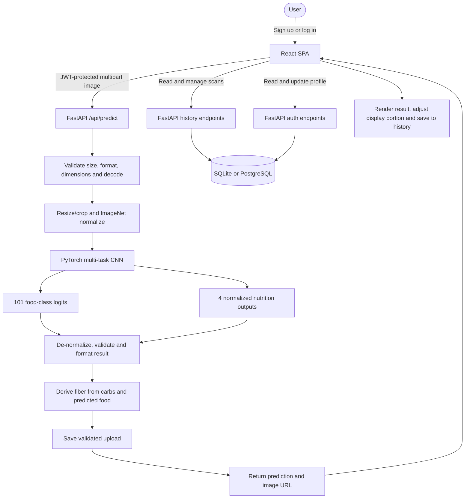
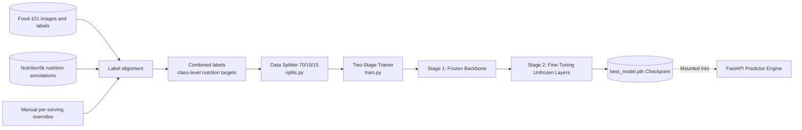

# 🥗 NutriVision AI – Comprehensive Project Documentation

> **AI-Powered Food Image Identification, Calorie Estimation & Macronutrient Regression System**  
> *Author / Developer: Karan Vishwajyoth*  
> *Last Updated: November 2026*
>
> **Document status:** this report describes the implemented system, but
> [README.md](README.md) and [ml/MODEL_CARD.md](ml/MODEL_CARD.md) are the
> authoritative references. A checkpoint trained on 2026-11-17 is installed at
> `backend/app/best_model.pth`: held-out validation top-1 **78.9%**, calorie MAE
> **48.2 kcal** (nutrition targets are class-level proxies — see §2). The API
> still returns `503` whenever the checkpoint is missing or fails validation.

---

## 📋 Table of Contents
1. [Project Overview & Vision](#1-project-overview--vision)
2. [Current Completion Status (Where the Project Stands)](#2-current-completion-status-where-the-project-stands)
3. [Technology Stack](#3-technology-stack)
4. [System Architecture & Data Flow](#4-system-architecture--data-flow)
5. [Complete Directory & File Structure](#5-complete-directory--file-structure)
6. [Core Features & User Experience](#6-core-features--user-experience)
7. [Machine Learning Pipeline Details](#7-machine-learning-pipeline-details)
8. [Backend API Specification](#8-backend-api-specification)
9. [How to Run & Deploy](#9-how-to-run--deploy)
10. [Roadmap & Future Enhancements](#10-roadmap--future-enhancements)

---

## 1. Project Overview & Vision

**NutriVision AI** is an end-to-end food-image analysis application for logging approximate nutrition estimates. A user uploads a photo, and a multi-task CNN predicts one of 101 Food-101 classes plus four nutrition values. These nutrition values are class-level estimates, not precise per-image or portion measurements.

- **Food Category Classification**: Recognizes the dish among 101 distinct culinary categories.
- **Nutrition Estimates**: Predicts calories, protein, carbohydrates, and fat. Fiber is derived from predicted carbohydrates and the predicted food name; it is not a model output.
- **Portion Display Control**: The result page lets a user scale displayed nutrition values using a portion multiplier. This is a UI calculation, not image-based portion detection.
- **Confidence Feedback**: Shows the classifier's top-class confidence and a low-confidence warning with retake guidance.
- **Personal Logging**: Saves results to a database-backed history isolated to each authenticated user.

The repository is structured into two complementary ecosystems:
1. **Full-Stack Application Layer**: A responsive modern React frontend coupled with an asynchronous Python FastAPI backend, fully containerized with Docker.
2. **Machine Learning Pipeline Layer**: An end-to-end dataset preparation, label alignment (Food-101 + Nutrition5k), multi-task training, loss weight sweeping, and checkpoint evaluation suite.

---

## 2. Current Completion Status (Where the Project Stands)

Here is an honest, granular audit of the implementation status across all subsystems:

| Subsystem | Component | Status | Details |
| :--- | :--- | :---: | :--- |
| **Frontend** | Landing Page (`Home.jsx`) | **100% Complete** | Hero section, feature showcases, workflow steps, interactive tech stack showcase, responsive navigation. |
| **Frontend** | Authentication (`AuthContext`, `Login`, `Signup`) | **100% Complete** | Live backend JWT integration + 1-click **Demo Account Mode** with token interceptors and local storage state persistence. |
| **Frontend** | Dashboard (`Dashboard.jsx`, `QuickStats.jsx`) | **100% Complete** | Personalized metrics, 4 top stat cards, daily calorie & protein progress bars, quick scan access. |
| **Frontend** | Food Scanner UI (`FoodUploader.jsx`, `ScanningOverlay.jsx`) | **100% Complete** | Drag-and-drop zone, camera upload trigger, image format/size validation, animated neon laser scanning beam. |
| **Frontend** | Analysis Breakdown (`Result.jsx`, `NutritionChart.jsx`) | Implemented | Nutrition cards, macro energy donut chart, adjustable display portion multiplier, confidence and dietary labels, copy and JSON export actions. |
| **Frontend** | Scan History (`History.jsx`, `HistoryContext.jsx`) | Implemented | Grid/table views, search by food or tag, protein/calorie filters, date/calorie/protein sorting, detail view, delete-one and clear-all. History is persisted per user by the backend. |
| **Frontend** | Profile & Goals (`Profile.jsx`) | Implemented | User profile, daily calorie/protein goals, and password change. |
| **Backend API** | FastAPI Service (`backend/app/main.py`) | Implemented | Health, authenticated prediction, signup/register, login, current profile, profile update (`PATCH`), password change, logout acknowledgement, and user-scoped history endpoints. |
| **Backend API** | Database Layer (`backend/app/database.py`) | Implemented | SQLAlchemy persistence with SQLite by default, PostgreSQL configurable through `DATABASE_URL`, and user-scoped prediction history. |
| **Backend API** | Real Authentication (`backend/app/auth.py`) | **100% Complete** | bcrypt password hashing via passlib + RFC 7519 HMAC-SHA256 JWT tokens, password change, and bearer auth dependencies. Production mode refuses to start without `SECRET_KEY`. |
| **Backend API** | Schemas & Contracts (`schemas.py`) | **100% Complete** | Strict Pydantic v2 validation models for requests, auth payloads, health status, and full nutritional predictions. |
| **Backend API** | Integration Tests (`backend/tests/`) | Implemented | API tests cover health, authentication, user-isolated history, upload checks, password changes, model readiness, and checkpoint validation. Run the tests locally to confirm the current result. |
| **Backend API** | Inference Runner (`predictor.py`) | **100% Complete** | Torchvision pipeline transforms, tensor conversion, batching, inference timing, threadpool execution, and safety error checks. |
| **Backend API** | Checkpoint Gate (`model_validation.py`) | **100% Complete** | Rejects missing class names, nutrition stats, validation metrics, class/output mismatches, and untrained BatchNorm statistics; surfaces codes through `/api/health` and 503 responses. |
| **Backend API** | Neural Architecture (`model.py`) | Implemented | `MultiTaskFoodCNN` with ResNet-50 backbone, a 101-class classification head, and one four-value regression head. |
| **DevOps** | Containerization (`Dockerfile`, `docker-compose.yml`) | **100% Complete** | Multi-container setup (nginx SPA + FastAPI) built and smoke-tested end to end on 2026-11-25: `/api/health` healthy with the checkpoint loaded, containerized login → predict → history verified through the nginx proxy. Backend image installs CPU-only PyTorch wheels (2.9 GB total, no unused CUDA stack). |
| **ML Pipeline** | Data Ingestion (`download_food101.py`, `prepare_nutrition5k.py`) | **100% Complete** | Automated downloaders and formatters for Food-101 and Nutrition5k cafeteria datasets. |
| **ML Pipeline** | Label Alignment (`align_labels.py`) | **100% Complete** | Fuzzy string matching with SequenceMatcher, threshold tuning, and manual overrides YAML. |
| **ML Pipeline** | Splits & Dataset (`splits.py`, `food_dataset.py`) | **100% Complete** | Stratified split manifest generator (70/15/15), PyTorch `Dataset` with official Food-101 partitions. |
| **ML Pipeline** | Multi-Task Training (`train.py`, `losses.py`) | **100% Complete** | Two-stage training regime (frozen feature extraction followed by partial backbone unfreezing), AMP mixed precision, checkpointing. |
| **ML Pipeline** | Evaluation Suite (`ml/evaluation/evaluate.py`) | **100% Complete** | Computes Top-1/Top-5 accuracy, macro F1, MAE, RMSE, Pearson $r$, $R^2$ score per nutrient, with automated JSON & Markdown export. |
| **ML Pipeline** | Quantization & Optimization (`ml/inference/export_and_quantize.py`, `ml/optimization/`) | **100% Complete** | Dynamic INT8 quantization, L1 pruning (20/30/50%), TorchScript/ONNX export, and FP32 vs pruned vs INT8 latency + held-out accuracy benchmark (`ml/optimization/benchmark_results.md`). |
| **ML Pipeline** | Hyperparameter Sweeps (`sweep_loss_weights.py`) | **Implemented, not executed** | Grid-search script over $\lambda_{\text{cls}}$ and $\lambda_{\text{reg}}$ is written and covered by tests, but no sweep run is recorded; `base.yaml` defaults ($\lambda_{\text{cls}}=\lambda_{\text{reg}}=1.0$) are used for the installed checkpoint. |
| **ML Pipeline** | Jupyter Notebooks (`ml/notebooks/`) | **100% Complete** | 4 structured notebooks: environment check, data exploration, pipeline sanity checks, and loss weight analysis. |
| **ML Pipeline** | Automated Unit Tests (`ml/tests/`) | **100% Complete** | Pytest suites verifying tensor shapes, losses, metrics, evaluation pipeline, and inference quantization. |
| **Model Weights** | Trained `.pth` Checkpoint | **100% Complete** | Trained 2026-11-17 on the full Food-101 split (70,700 train / 15,150 val). Validation top-1 **78.9%**, calorie MAE **48.2 kcal**; checkpoint at `backend/app/best_model.pth` passes the validation gate. |

> [!IMPORTANT]
> The metrics above are the checkpoint's own held-out validation results.
> Classification accuracy uses real per-image Food-101 labels, but nutrition
> targets are **per-class constants** (7 classes from matched Nutrition5k dish
> annotations, 94 documented per-serving estimates), so the regression MAE
> measures agreement with those class priors rather than per-dish ground truth.
> Quote only numbers that appear in `val_metrics` or an evaluation run.

---

## 3. Technology Stack

### Frontend
- **Runtime/UI**: React 19 with React DOM; functional components, hooks, and React Context.
- **Build/dev server**: Vite 8 with the React plugin.
- **Styling**: Tailwind CSS 3.4 and project CSS.
- **Routing**: React Router 7 with protected routes and lazy-loaded pages.
- **Charts and icons**: Recharts 3 and Lucide React; Canvas Confetti is used for result feedback.
- **HTTP**: Axios, JWT request interceptor, 401 session-expiry handling, Vite development proxy.
- **Linting**: Oxlint.

### Backend
- **Language/runtime**: Python 3.11+ (recommended in the project README).
- **API/server**: FastAPI 0.115 and Uvicorn.
- **Validation**: Pydantic 2.
- **Persistence**: SQLAlchemy 2, Alembic migration environment, SQLite by default, PostgreSQL supported through `DATABASE_URL`.
- **Authentication**: `python-jose` JWT, passlib/bcrypt password hashing.
- **Image and upload handling**: Pillow, `python-multipart`, static `/uploads` serving.

### Machine learning
- **Framework**: PyTorch and Torchvision (training requirements pin PyTorch 2.6.0 and Torchvision 0.21.0).
- **Backbones**: ResNet-50 is used for the installed checkpoint; EfficientNet-B0 is supported by the model implementation.
- **Outputs**: 101 class logits and four normalized values `[calories, protein, carbohydrates, fat]`. Fiber is estimated separately at inference.
- **Data/tools**: Food-101, aligned Nutrition5k data, NumPy, Pandas, scikit-learn, PyYAML, tqdm, Matplotlib.
- **Training/evaluation**: Pytest, two-stage training, checkpoint validation, evaluation and optimization scripts.

### Deployment
- Docker and Docker Compose run the FastAPI backend and the frontend served by nginx.
- nginx serves the single-page app and proxies `/api` and `/uploads`.
- Compose uses health checks and named data/upload volumes. Production requires `SECRET_KEY`.

---

## 4. System Architecture & Data Flow

A ready-to-present diagram is checked in at [`docs/architecture.svg`](docs/architecture.svg)
(client, backend, model inference, and the offline ML pipeline on one canvas).
The Mermaid diagrams below expand the request flow and the training pipeline.

### Application Workflow



### ML Pipeline Data Flow



---

## 5. Project Structure

This is the main source layout; virtual environments, installed packages, generated
builds, datasets, model weights, and local runtime data are omitted.

```text
c:\Users\KARAN\Food Image Calorie Estimator\
│
├── docker-compose.yml                    # Multi-container orchestration (Frontend + Backend)
├── README.md                             # High-level repository summary & quick start
├── PROJECT_DOCUMENTATION.md              # Complete exhaustive project documentation (This file)
├── DEPLOYMENT.md                          # Hosting, TLS, backups, and deployment verification
│
├── backend/                              # FastAPI Python Backend
│   ├── Dockerfile                        # Python 3.11 container definition
│   ├── requirements.txt                  # Backend Python dependencies
│   ├── app/                              # Application source code
│   │   ├── __init__.py                   # Package initializer
│   │   ├── main.py                       # FastAPI application setup, CORS, and REST route handlers
│   │   ├── model.py                      # MultiTaskFoodCNN PyTorch model architecture
│   │   ├── predictor.py                  # Image loader, transforms, and inference execution engine
│   │   ├── model_validation.py            # Checkpoint validation and rejection reasons
│   │   ├── models.py                     # SQLAlchemy user and food-prediction ORM models
│   │   ├── database.py                   # Persistence setup and user/history operations
│   │   ├── auth.py                       # bcrypt password hashing & RFC 7519 JWT auth handling
│   │   └── schemas.py                    # Pydantic data validation contracts (Prediction, Auth, History)
│   ├── alembic/                          # Database migration environment and revisions
│   └── tests/                            # Backend API and model-validation tests
│
├── frontend/                             # React + Vite Single Page Web Application
│   ├── index.html                        # SPA HTML root entry point with Google Fonts
│   ├── package.json                      # Frontend dependencies, scripts, and build configurations
│   ├── package-lock.json                 # Pinned dependency lockfile
│   ├── vite.config.js                    # Vite bundler configuration with React plugin
│   ├── tailwind.config.js                # Custom Tailwind design system tokens, colors & shadows
│   ├── postcss.config.js                 # PostCSS autoprefixer configuration
│   ├── nginx.conf                        # Production Nginx reverse-proxy and client-routing configuration
│   ├── Dockerfile                        # Multi-stage production container build (Vite -> Nginx)
│   ├── .oxlintrc.json                    # Oxlint static analysis rules
│   ├── .gitignore                        # Frontend build output exclusions
│   ├── public/                           # Static public assets (Favicon, icons)
│   └── src/
│       ├── main.jsx                      # React application bootstrap entry
│       ├── App.jsx                       # Declarative route configuration and ProtectedRoute logic
│       ├── index.css                     # Global Tailwind directives and base typography
│       ├── App.css                       # Custom animations and laser scan keyframes
│       │
│       ├── components/                   # Modular UI components
│       │   ├── Navbar.jsx                # Global navigation bar with responsive mobile menu
│       │   ├── Sidebar.jsx               # Dashboard sidebar navigation with user badge & route links
│       │   ├── DashboardHeader.jsx       # Dynamic greetings, breadcrumbs, and quick action buttons
│       │   ├── QuickStats.jsx            # 4 metric cards (Total Scans, Calories, Protein, Week Count)
│       │   ├── FoodUploader.jsx          # File dropzone, camera trigger, file validation & preview
│       │   ├── ScanningOverlay.jsx       # Futuristic scanning beam animation over food photos
│       │   ├── NutritionCard.jsx         # Card displaying nutrient weight, % Daily Value, and progress bar
│       │   ├── NutritionChart.jsx        # Donut chart rendering macro caloric percentage distribution
│       │   ├── ConfidenceBadge.jsx       # Color-coded pill reflecting AI confidence score
│       │   ├── LowConfidenceAlert.jsx    # Warning card triggered when prediction confidence < 65%
│       │   ├── LoadingState.jsx          # Engaging multi-step loader during AI inference
│       │   ├── DisclaimerBanner.jsx      # FDA/medical disclaimer on AI nutritional approximations
│       │   └── Toast.jsx                 # Dynamic floating notification alerts
│       │
│       ├── context/                      # Global state management via React Context
│       │   ├── AuthContext.jsx           # User authentication, demo session, and profile updater
│       │   └── HistoryContext.jsx        # Scan history state (backend-synced) and analytics aggregator
│       │
│       ├── pages/                        # Route page views
│       │   ├── Home.jsx                  # Marketing landing page with hero, tech stack, and workflow
│       │   ├── Login.jsx                 # Login form with 1-click Demo Account login
│       │   ├── Signup.jsx                # Account creation form with validation
│       │   ├── Dashboard.jsx             # User home showing quick stats, scanner, and recent scans
│       │   ├── Analyze.jsx               # Full-screen scanning workstation with tips & guidance
│       │   ├── Result.jsx                # Rich results breakdown, portion scaler, copy & JSON export
│       │   ├── History.jsx               # Searchable, filterable, sortable history catalog
│       │   └── Profile.jsx               # Account settings, calorie & protein goals, password update
│       │
│       └── services/
│           └── api.js                    # Axios client abstraction with endpoints and error fallbacks
│
└── ml/                                   # Machine Learning Research & Training Pipeline
    ├── requirements.txt                  # Python training dependencies (PyTorch 2.6, Torchvision, etc.)
    │
    ├── configs/
    │   └── base.yaml                     # Central YAML config (Data paths, hyperparams, training stages)
    │
    ├── data/
    │   ├── download_food101.py           # Automated downloader & extractor for Food-101
    │   ├── prepare_nutrition5k.py        # Nutrition5k metadata parser & CSV clean-up
    │   ├── align_labels.py               # Fuzzy text matcher aligning Food-101 to Nutrition5k targets
    │   ├── splits.py                     # Deterministic stratified 70/15/15 train/val/test splitter
    │   ├── food_dataset.py               # PyTorch Food101NutritionDataset implementation
    │   ├── manual_overrides.yaml         # Manual text overrides for edge-case food dish matches
    │   └── DATA_AUDIT.md                 # Quality audit notes, outlier documentation & assumptions
    │
    ├── models/
    │   ├── multitask_cnn.py              # ResNet-50 / EfficientNet-B0 multi-task architecture
    │   └── checkpoint.py                 # Safe checkpoint saving/loading utilities
    │
    ├── preprocessing/
    │   └── transforms.py                 # Torchvision data augmentation & normalization pipelines
    │
    ├── training/
    │   ├── train.py                      # Two-stage multi-task training loop with AMP support
    │   ├── losses.py                     # MultiTaskLoss balancing classification and regression
    │   ├── sweep_loss_weights.py         # Grid search script evaluating candidate loss weight pairs
    │   ├── compare_runs.py               # Comparative metrics table generator for training sweeps
    │   └── RUN_INSTRUCTIONS.md           # Step-by-step Google Colab T4 GPU execution guide
    │
    ├── evaluation/                       # Model evaluation & benchmarking
    │   └── evaluate.py                   # Test split evaluation (Top-1/5, F1, MAE, RMSE, Pearson r, R2)
    │
    ├── inference/                        # Post-training export and runtime preparation
    │   └── export_and_quantize.py        # INT8 dynamic quantization, TorchScript & ONNX export
    ├── optimization/                     # Pruning, quantization, and benchmark tools/results
    │
    ├── notebooks/                        # Interactive Jupyter experimentation notebooks
    │   ├── 00_environment_check.ipynb    # Validates GPU accelerator, CUDA drivers, and libraries
    │   ├── 01_data_exploration.ipynb     # Dataset inspection, class distribution & outlier analysis
    │   ├── 02_pipeline_sanity_check.ipynb# Overfitting test on tiny batch to verify loss convergence
    │   └── 03_loss_weight_analysis.ipynb # Interactive sweep plots for lambda_cls vs lambda_reg
    │
    └── tests/                            # Automated Pytest suite for ML modules
        ├── test_model_shapes.py          # Verifies output tensor dimensions for backbones
        ├── test_losses.py                # Tests multi-task loss calculation and weighting
        ├── test_train_metrics.py         # Tests accuracy, MAE, and evaluation metric functions
        ├── test_evaluation.py            # Tests classification & regression evaluation calculations
        └── test_inference_optimization.py# Tests INT8 quantization and TorchScript tracing

```

---

## 6. Core Features & User Experience

### 1. Image analysis workflow
The user selects an image in the upload/analyze flow. The frontend validates the selection and shows an animated scanning state while it sends the image to the backend. The backend performs the authoritative file checks and inference. The animation is a presentation effect; it does not represent a separate scanning or image-processing model.

### 2. Multi-Task Nutrition Predictions
The installed model produces:
- **Food Class**: Identified dish name and category.
- **Nutrition regression**: Calories, protein, carbohydrates, and fat. Regression targets are z-scored during training and de-normalized by the predictor.
- **Derived fiber**: A deterministic category-based estimate from predicted carbohydrates; it is not predicted by a model head.
- **Confidence Metric**: Confidence score expressed as a percentage, visually highlighted with color-coded badges (`Emerald` for high, `Amber` for moderate, `Rose` for low).

Nutrition estimates are based on class-level targets, so they should not be interpreted as precise measurements of the photographed plate. The model does not estimate food mass or portion size from image geometry.

### 3. Portion display multiplier
The result view can multiply the displayed calories and nutrient values for a manually selected portion. This is a front-end convenience; the original prediction remains the model estimate and no portion detector is run.

### 4. Macro energy donut chart
Built using Recharts, the chart calculates the caloric contribution of each macronutrient:
$$\text{Caloric Contribution} = (\text{Protein} \times 4) + (\text{Carbs} \times 4) + (\text{Fat} \times 9)$$
Displays macro energy shares using the current displayed portion values.

### 5. Low-Confidence Safeguards
When the class confidence is below the configured threshold, the system displays a `LowConfidenceAlert` banner with retake guidance:
- Ensure adequate lighting.
- Keep the plate centered in frame.
- Avoid blurry overhead angles.

### 6. Scan History & Search Workstation
- Persists every analysis in the FastAPI backend database, scoped to the signed-in user.
- Allows switching between **Grid View** and **Table View**.
- Searches food names and dietary tags.
- Filters by *High Protein (25g+)*, *Under 450 kcal*, or *650+ kcal*.
- Sorts by newest/oldest, calories, or protein.
- Opens a saved result, deletes one record, or clears all records for the current account.

### 7. Nutrition goals and dashboard statistics
- Users can set daily calorie and protein goals in `Profile.jsx`.
- Dashboard statistics are derived from saved history, including today's logged calories and protein and a recent-scan count.
- These are summaries of saved estimates, not verified food intake.

---

## 7. Machine Learning Pipeline Details

### Problem Formulation
Food calorie estimation is framed as a **Multi-Task Supervised Learning** problem. Given an RGB food image $x \in \mathbb{R}^{3 \times 224 \times 224}$, the network predicts:
1. Classification logits: $\hat{y}_{\text{cls}} \in \mathbb{R}^{C}$ (where $C = 101$).
2. Nutrition targets: $\hat{y}_{\text{nutr}} \in \mathbb{R}^{4}$ representing $[\text{calories}, \text{protein}, \text{carbs}, \text{fat}]$.

### Multi-Task Loss Objective
The composite loss function balances classification error with continuous regression error:
$$\mathcal{L}_{\text{total}} = \lambda_{\text{cls}} \mathcal{L}_{\text{cls}}(\hat{y}_{\text{cls}}, y_{\text{cls}}) + \lambda_{\text{reg}} \mathcal{L}_{\text{reg}}(\hat{y}_{\text{nutr}}, y_{\text{nutr}})$$
Where:
- $\mathcal{L}_{\text{cls}}$ is Cross-Entropy Loss with optional label smoothing.
- $\mathcal{L}_{\text{reg}}$ is Smooth L1 Loss (Huber Loss) to remain robust against outlier nutrition values.
- $\lambda_{\text{cls}}$ and $\lambda_{\text{reg}}$ are swept by `sweep_loss_weights.py`; no sweep has been completed in this repository yet, so the defaults in `ml/configs/base.yaml` are used.

### Two-Stage Training Regime (`train.py`)
To prevent the random initialization of the regression and classification heads from destroying pretrained ImageNet weights:
1. **Stage 1 (Feature Extraction)**: The backbone is frozen and the classification/regression heads are trained.
2. **Stage 2 (Fine-Tuning)**: The configured deepest backbone stage is unfrozen and fine-tuned with the heads at a lower learning rate. AMP is used when configured and supported.

The base YAML configuration specifies two frozen-stage epochs and eight fine-tuning epochs. The installed checkpoint was produced with CLI overrides for four epochs total: one frozen epoch followed by three fine-tuning epochs (see the measured run below).

### Measured Training Run (2026-11-17)
The installed checkpoint was trained on the full Food-101 split (70,700 train /
15,150 validation images, seed 42) with CLI overrides for a short run: 1 frozen
epoch at lr $10^{-3}$, then 3 fine-tuning epochs at lr $10^{-4}$ with cosine decay,
batch 32, and AMP.

```bash
.venv/Scripts/python.exe -m ml.training.train --device cuda --epochs 4 \
  --freeze-backbone-epochs 1 --batch-size 32 --num-workers 4 \
  --scheduler cosine --checkpoint-dir ml/training/checkpoints
cp ml/training/checkpoints/best.pt backend/app/best_model.pth
```

| Metric | Validation (trained) | Test (held out) |
| --- | --- | --- |
| Top-1 accuracy | 78.86% | 78.86% |
| Top-5 accuracy | — | 93.92% |
| Calories MAE | 48.18 kcal | 48.44 kcal |
| Protein / carbs / fat MAE | 3.99 / 7.75 / 3.29 g | 3.99 / 7.87 / 3.35 g |

The classification figures use real per-image Food-101 labels. Nutrition
targets are per-class constants (7 classes from matched Nutrition5k dish
annotations, 94 curated per-serving estimates), so the regression rows measure
how closely the model reproduced those class priors — not per-dish laboratory
truth. Test artifacts and the per-class breakdown are in
`ml/evaluation/results/`.

### Optimization & Benchmark Results (2026-11-25)

All variants were derived from the installed checkpoint:
`prune.py --checkpoint backend/app/best_model.pth --fine-tune-batches 300
--learning-rate 5e-5`, `quantize.py --checkpoint backend/app/best_model.pth`,
then `benchmark.py --max-test-samples 1500`. Accuracy is measured on 1,504
held-out test images drawn with a fixed shuffle; latency is 100 runs after 15
warmups on the benchmark host.

| Variant | Size | CPU mean | GPU mean | Top-1 | Top-5 | Calorie MAE |
| --- | --- | --- | --- | --- | --- | --- |
| FP32 baseline | 96.17 MB | 44.81 ms | 8.29 ms | 77.93% | 94.41% | 48.99 kcal |
| Pruned 20% | 96.19 MB | 47.20 ms | 8.74 ms | 76.20% | 93.02% | 49.80 kcal |
| Pruned 30% | 96.19 MB | 44.10 ms | 8.59 ms | 75.93% | 92.75% | 50.56 kcal |
| Pruned 50% | 96.19 MB | 45.71 ms | 9.04 ms | 75.07% | 92.49% | 51.61 kcal |
| Dynamic INT8 | 91.65 MB | 45.39 ms | N/A | 79.52% | 94.48% | 47.94 kcal |

L1 pruning is unstructured, so tensors stay dense: file size and dense-kernel
latency are essentially unchanged while accuracy drops ~1.7–2.9 points at
20–50% sparsity. Dynamic INT8 only converts the Linear head (convolutions, the
bulk of ResNet-50 FLOPs, stay FP32), giving a 4.7% size reduction with no
meaningful latency change; its 79.5% top-1 is within sampling noise of FP32.
The full generated report is `ml/optimization/benchmark_results.md`
(CSV alongside it).

---

## 8. Backend API Specification

The FastAPI backend runs on port `8000` by default. Interactive OpenAPI Swagger documentation is available at `http://localhost:8000/docs`.

### Key Endpoints

#### 1. System Health Check
- **Route**: `GET /api/health`
- **Description**: Returns operational status, device, checkpoint path, and the
  checkpoint validation report. If the configured checkpoint is invalid,
  `modelReady` is `false` and `POST /api/predict` returns `503`.
- **Response** (measured on 2026-11-17, trained checkpoint, GPU host; fields
  abbreviated where noted):
```json
{
  "status": "healthy",
  "modelLoaded": true,
  "modelReady": true,
  "modelArchitecture": "MultiTaskFoodCNN (ResNet50 Backbone + Calorie/Macro Regression)",
  "modelVariant": "fp32",
  "device": "cuda",
  "version": "1.0.0",
  "checkpointPath": "...\\backend\\app\\best_model.pth",
  "trainedMetrics": {
    "loss": 0.9438,
    "accuracy": 0.7886,
    "calories_mae": 48.18,
    "protein_mae": 3.99,
    "carbohydrates_mae": 7.75,
    "fat_mae": 3.29
  },
  "modelValidation": {
    "valid": true,
    "errors": [],
    "warnings": [],
    "num_classes": 101
  }
}
```

#### 2. Food Image Prediction
- **Route**: `POST /api/predict`
- **Auth**: Bearer JWT
- **Content-Type**: `multipart/form-data`
- **Form Field**: `image` (decodable JPEG, PNG, or WEBP; max 15 MB and max 8000 pixels per side)
- **Otherwise**: `503` when no valid checkpoint is installed; `400` for decode/format violations.
- **Response Schema** (measured response for a Food-101 pizza image on
  2026-11-17; inference time is the first, cold request — warm requests measured
  ~46 ms):
```json
{
  "id": "pred_18a0c3a242",
  "foodClass": "Pizza",
  "category": "Fast Food",
  "confidenceScore": 1.0,
  "confidencePercentage": 100.0,
  "estimatedCalories": 437.0,
  "protein": 29.6,
  "carbohydrates": 37.2,
  "fat": 20.9,
  "fiber": 3.7,
  "servingSize": "1 standard serving (class-average estimate)",
  "isLowConfidence": false,
  "healthRating": "High Protein",
  "dietaryTags": ["High Protein"],
  "healthTips": "pizza is estimated at 437 kcal for one standard serving (29.6g protein, 37.2g carbs, 20.9g fat).",
  "inferenceTimeMs": 398.2,
  "imageUrl": "/uploads/0b605bbf729a4fbcb045d102b3f2387d.jpg"
}
```

#### 3. History Management
- `GET /api/history?limit=20&offset=0`: Lists records for the authenticated user.
- `POST /api/history`: Saves a prediction; the server assigns the id.
- `DELETE /api/history/{item_id}`: Deletes one record owned by the caller.
- `DELETE /api/history`: Clears all records for the caller.

#### 4. Authentication
- `POST /api/auth/signup` (also available as `/api/auth/register`) and `POST /api/auth/login`: Return a JWT and user profile.
- `GET /api/auth/me`, `PATCH /api/auth/profile`: Read and update name/goals.
- `POST /api/auth/change-password`: Verifies the current password and returns a new JWT.
- `POST /api/auth/logout`: Acknowledges logout; JWTs are stateless and the client discards its token.

---

## 9. How to Run & Deploy

### Method 1: Instant Multi-Container Docker Deployment (Recommended)
Make sure Docker Desktop is running, create a `.env` with a real `SECRET_KEY`
(`openssl rand -hex 32`), then execute from the project root:

```bash
docker compose up --build
```

- **Frontend**: Access at `http://localhost:3000` (nginx proxies `/api` and `/uploads`)
- **Backend API**: Access at `http://localhost:8000`
- **Interactive Swagger Docs**: Access at `http://localhost:8000/docs`

Compose runs with `APP_ENV=production` and refuses to start without
`SECRET_KEY`. Demo seeding is disabled by default; set `SEED_DEMO=true` to
enable the demo account.

---

### Method 2: Running Locally (Bare Metal)

#### Configure environment
Copy `.env.example` to `.env` at the repository root. Set a strong `SECRET_KEY`
for production; the backend refuses to start in production without it. Review
`APP_ENV`, `DATABASE_URL`, `DATA_DIR`, `UPLOADS_DIR`, `MODEL_VARIANT`,
`MODEL_WEIGHTS_PATH`, `CORS_ORIGINS`, `SEED_DEMO`, and `VITE_API_URL` for the
environment you are running. Do not commit the real `.env` file.

The backend validates the configured model checkpoint during startup. The
included `backend/app/best_model.pth` is used by default; if it is missing or
rejected, `/api/health` reports the reason and `/api/predict` returns `503`.
This is distinct from API health: the service can be reachable while its model
is not ready to predict.

#### Step 1: Start the React Frontend
```bash
cd frontend
npm install
npm run dev
```
The frontend starts on `http://localhost:5173`. You can immediately log in with the **1-Click Demo Account**.

#### Step 2: Start the FastAPI Backend
```bash
cd backend
python -m venv ../.venv
# Windows PowerShell:
..\.venv\Scripts\Activate.ps1
# On Linux/macOS:
source ../.venv/bin/activate

pip install -r requirements.txt
uvicorn app.main:app --reload --port 8000
```

#### Run tests and checks
From the repository root, run the focused backend and ML test suites and build
the frontend:

```bash
.venv/Scripts/python.exe -m pytest backend/tests -q
.venv/Scripts/python.exe -m pytest ml/tests -q
cd frontend
npm run lint
npm run build
```

The backend API docs are available at `http://localhost:8000/docs`. For data
preparation and GPU training details, see `ml/training/RUN_INSTRUCTIONS.md`;
for deployment options and operational guidance, see `DEPLOYMENT.md`.

---

### Method 3: Training the Model on Google Colab (GPU)
For users who wish to train the neural network from scratch using a free Google Colab T4 GPU:

1. Open Google Colab and set Runtime to **T4 GPU**.
2. Clone the repository and install requirements:
   ```python
   !git clone https://github.com/KARANVISHWAJYOTH/Food-Image-Calorie-Estimator.git
   %cd Food-Image-Calorie-Estimator
   !python -m pip install -r ml/requirements.txt
   ```
3. Download Food-101 and prepare Nutrition5k:
   ```python
   !python ml/data/download_food101.py
   !python ml/data/align_labels.py
   !python ml/data/splits.py
   ```
4. Launch the two-stage training script:
   ```python
   !python ml/training/train.py --device cuda
   ```
5. Download the resulting `best_model.pth` checkpoint, place it into `backend/app/`, set `MODEL_WEIGHTS_PATH=backend/app/best_model.pth`, and restart the backend.

---

## 10. Roadmap & Future Enhancements

- [x] **Trained Weights Installed**: 4-epoch run on the full Food-101 split (78.9% top-1, 48.2 kcal calorie MAE) shipped at `backend/app/best_model.pth` and passing the checkpoint gate. A longer 10-epoch schedule (`num_epochs` in `base.yaml`) remains an optional accuracy improvement, not a blocker.
- [ ] **Loss-Weight Sweep Execution**: Run `sweep_loss_weights.py` on GPU and record the selected $\lambda$ pair; the current checkpoint uses the defaults.
- [x] **Database Persistence**: SQLAlchemy 2.0 persistence with SQLite by default and PostgreSQL via `DATABASE_URL`; Alembic migration environment included.
- [x] **JWT User Authentication**: bcrypt password hashing, JWT bearer auth, password change, and logout acknowledgement.
- [ ] **Mobile Progressive Web App (PWA)**: Implement service workers and manifest files for native-like home screen installation on iOS and Android.
- [ ] **Volumetric Depth Estimation**: Integrate LiDAR / ARKit depth maps to estimate food volume in cubic centimeters before calculating caloric density.
- [ ] **Barcode Scanning Integration**: Combine visual CNN recognition with OpenFoodFacts barcode scanning for packaged foods.

---

> *Developed with passion by **Karan Vishwajyoth**.*  
> *Project Licensed under MIT License.*
