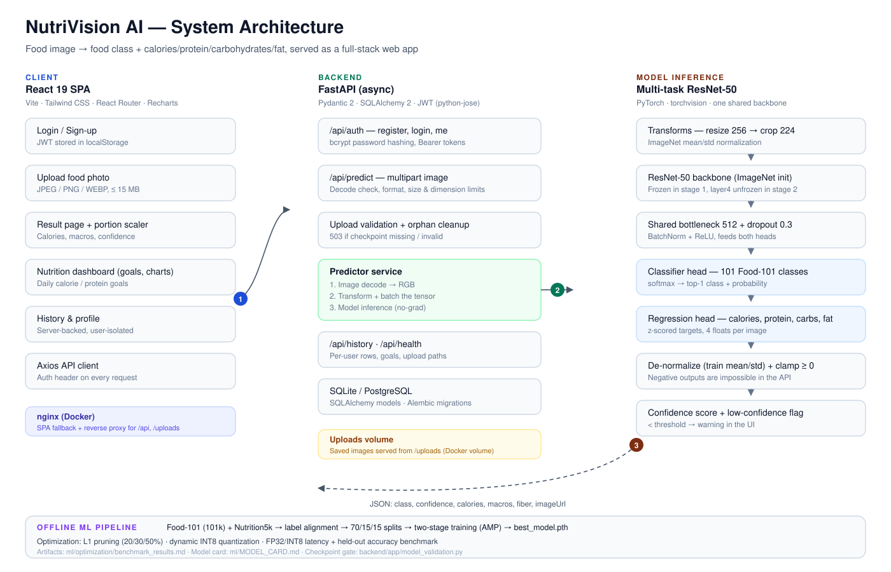

# NutriVision AI — Food Image Calorie & Macro Estimator

Full-stack app that classifies a food photo and regresses calories, protein,
carbohydrates, and fat with a multi-task ResNet-50, served through FastAPI and a
React dashboard.

[](https://react.dev/)
[](https://vite.dev/)
[](https://fastapi.tiangolo.com/)
[](https://pytorch.org/)

> **Model status:** a checkpoint trained on 2026-11-17 is installed at
> `backend/app/best_model.pth`. Held-out validation (15,150 images): **78.9%
> top-1** classification and **48.2 kcal** calorie MAE. Classification is
> evaluated against real per-image Food-101 labels; nutrition targets are
> class-level proxies, so the regression metrics measure agreement with those
> priors (see [Model & training](#model--training)). The API validates the
> checkpoint at startup and returns `503` for `/api/predict` whenever the file is
> missing or fails validation, so a fresh clone without the checkpoint cannot
> serve predictions.

---

## Features

- JWT auth: signup, login, 1-click demo account, password change, logout.
- Upload validation before inference (real image decode, JPEG/PNG/WEBP, size and
  dimension limits, 15 MB cap) and orphan-file cleanup on failure.
- Multi-task inference: 101-class classifier plus 4 regression outputs
  (calories, protein, carbohydrates, fat); dietary fiber is derived
  deterministically from predicted carbs and the food category.
- Per-user history persisted with SQLAlchemy (SQLite by default, PostgreSQL via
  `DATABASE_URL`): list, save, delete one, clear all. History is user-isolated
  on the server.
- Daily calorie/protein goals, dashboard stats from real records, live backend
  and model health indicator.
- Checkpoint validation gate (`backend/app/model_validation.py`) and a
  quantization/pruning/benchmark pipeline under `ml/optimization`.
- Docker Compose deployment with an nginx reverse proxy for `/api` and
  `/uploads`.

## Stack

| Layer | Technology |
| --- | --- |
| Frontend | React 19, Vite 8, Tailwind CSS 3.4, React Router 7, Axios, Recharts 3 |
| Backend | FastAPI 0.115, Pydantic 2, SQLAlchemy 2, Alembic, python-jose JWT, passlib/bcrypt |
| ML | PyTorch / Torchvision, ResNet-50 backbone, multi-task heads |
| Deployment | Docker, Docker Compose, nginx |

## Repository layout

```text
frontend/                  React SPA (pages, contexts, API service)
  src/services/api.js      Axios client; same-origin API by default
  vite.config.js           Dev proxy for /api and /uploads
  nginx.conf               SPA fallback + reverse proxy (Docker)
backend/
  app/main.py              FastAPI app, auth, upload, history, predict endpoints
  app/predictor.py         Model loading, transforms, inference, fiber derivation
  app/model_validation.py  Checkpoint gate (returns the exact rejection reasons)
  app/database.py          SQLAlchemy models, persistence helpers, demo seeding
  app/auth.py              bcrypt hashing, JWT creation/verification
  alembic/                 Migration environment
  tests/                   API + validation tests
ml/
  data/, preprocessing/    Food-101 / Nutrition5k ingestion, splits, transforms
  models/                  MultiTaskCNN and checkpoint helpers
  training/                Two-stage training, losses, sweeps, checkpoint check
  evaluation/              Top-1/5, F1, MAE/RMSE, Pearson r, R²
  inference/, optimization/ INT8 quantization, TorchScript/ONNX export, benchmarks
docker-compose.yml         Backend + frontend (nginx) with healthchecks
docs/architecture.svg      System + inference architecture diagram
```

## Getting started

Prerequisites: Python 3.11+, Node.js 20+.

### 1. Configure the environment

```bash
cp .env.example .env
# Set SECRET_KEY (required when APP_ENV=production): openssl rand -hex 32
```

Configuration is read from the repository-root `.env`. Relevant variables:
`SECRET_KEY`, `APP_ENV`, `ACCESS_TOKEN_EXPIRE_MINUTES`, `CORS_ORIGINS`,
`SEED_DEMO`, `MODEL_VARIANT` (`fp32` | `int8`), `MODEL_WEIGHTS_PATH`,
`DATABASE_URL`, `DATA_DIR`, `UPLOADS_DIR`, `VITE_API_URL`.

### 2. Run the backend

```bash
cd backend
python -m venv ../.venv          # once
../.venv/Scripts/activate         # Windows (use ../.venv/bin/activate on Unix)
pip install -r requirements.txt
uvicorn app.main:app --reload --port 8000
```

- API docs: `http://localhost:8000/docs`
- Health (model status, checkpoint path, validation report):
  `GET http://localhost:8000/api/health`
- Demo account when `SEED_DEMO` is not disabled:
  `demo@nutrivision.ai` / `demoPassword123`

### 3. Run the frontend

```bash
cd frontend
npm install
npm run dev
```

Open `http://localhost:5173`. The dev server proxies `/api` and `/uploads` to
`http://127.0.0.1:8000`, so no CORS setup is needed. Set `VITE_DEV_BACKEND_URL`
to point the proxy elsewhere.

### 4. Run tests

```bash
# from the repository root
.venv/Scripts/python.exe -m pytest backend/tests -q
.venv/Scripts/python.exe -m pytest ml/tests -q
cd frontend && npm run build
```

## Architecture



Open [docs/architecture.svg](docs/architecture.svg) for the full-size diagram.
Step-by-step Mermaid flows for the request path and the offline ML pipeline are in
[PROJECT_DOCUMENTATION.md](PROJECT_DOCUMENTATION.md#4-system-architecture--data-flow).

The runtime path is React SPA → Axios → FastAPI (`/api/predict`) → upload
validation → torchvision transforms → multi-task ResNet-50 → de-normalized,
clamped outputs → JSON response rendered on the result page and persisted to
SQLite/PostgreSQL. The offline path (Food-101 + Nutrition5k → label alignment →
splits → two-stage training → pruning/quantization/benchmark) produces the
checkpoint that the backend validates at startup.

## Model & training

`MultiTaskCNN` in `ml/models/multitask_cnn.py` shares a ResNet-50 backbone:

- `classification_head.3` → 101 Food-101 logits
- `regression_head.3` → 4 outputs `[calories, protein, carbohydrates, fat]`
  (targets z-scored with training-split statistics and de-normalized at
  inference)

Training uses two stages (frozen backbone, then `layer4` + heads) with AMP, as
implemented in `ml/training/train.py`. See `ml/training/RUN_INSTRUCTIONS.md` for
the Colab/GPU runbook.

The installed checkpoint came from this run on the full Food-101 split
(70,700 train / 15,150 validation images, seed 42):

```bash
.venv/Scripts/python.exe -m ml.training.train --device cuda --epochs 4 \
  --freeze-backbone-epochs 1 --batch-size 32 --num-workers 4 \
  --scheduler cosine --checkpoint-dir ml/training/checkpoints
cp ml/training/checkpoints/best.pt backend/app/best_model.pth
```

| Held-out metric (15,150 images) | Value |
| --- | --- |
| Top-1 classification accuracy | 78.9% |
| Top-5 classification accuracy | 93.9% |
| Calories MAE | 48.4 kcal (R² 0.71) |
| Protein MAE | 4.0 g |
| Carbohydrates MAE | 7.9 g |
| Fat MAE | 3.4 g |

The independent test split (15,150 images, never seen during training or model
selection) was evaluated with `ml/evaluation/evaluate.py`; artifacts and the full
per-class breakdown are in `ml/evaluation/results/`.

These numbers are embedded in the checkpoint's `val_metrics` and are surfaced by
`GET /api/health`. One caveat matters when reading the MAE rows: nutrition
targets are **per-class constants**, not per-image measurements. Seven classes
use an average of matched Nutrition5k dish annotations; the other 94 use
documented per-serving estimates (`ml/data/manual_overrides.yaml`). Every image
of a class shares one target, so the regression MAE mainly reflects how closely
the model reproduced those class priors. The classification accuracy is
evaluated on genuine per-image Food-101 labels.

A checkpoint is only served when `validate_checkpoint` accepts it: it must
contain `state_dict`/`model_state_dict`, `class_names`, `target_stats`,
`val_metrics` (accuracy and calories MAE), and non-default BatchNorm statistics.
Otherwise `/api/predict` returns `503` with the rejection codes from
`GET /api/health`.

Place the trained checkpoint at `backend/app/best_model.pth` (or point
`MODEL_WEIGHTS_PATH` at it). INT8 builds use `backend/app/best_model_int8.pth`
with `MODEL_VARIANT=int8`. Quantization, pruning, and latency benchmarking live
under `ml/optimization/`; see `ml/MODEL_CARD.md` for scope and limitations.

### Optimization results

All variants below were built from the installed checkpoint and evaluated on
1,504 held-out test images with `ml/optimization/benchmark.py`
(full report: `ml/optimization/benchmark_results.md`).

| Variant | Size | CPU latency | Top-1 | Top-5 | Calorie MAE |
| --- | --- | --- | --- | --- | --- |
| FP32 baseline | 96.2 MB | 44.8 ms | 77.9% | 94.4% | 49.0 kcal |
| Pruned 20% | 96.2 MB | 47.2 ms | 76.2% | 93.0% | 49.8 kcal |
| Pruned 30% | 96.2 MB | 44.1 ms | 75.9% | 92.8% | 50.6 kcal |
| Pruned 50% | 96.2 MB | 45.7 ms | 75.1% | 92.5% | 51.6 kcal |
| Dynamic INT8 | 91.7 MB | 45.4 ms | 79.5% | 94.5% | 47.9 kcal |

Pruning keeps most accuracy but does not reduce latency or file size here:
L1 pruning is unstructured, so tensors stay dense. Dynamic INT8 only converts
the Linear head, which is a small share of ResNet-50 FLOPs. Real CPU speedups
would need sparse-aware kernels or static quantization of the convolutions.


## API summary

| Method | Path | Auth | Purpose |
| --- | --- | --- | --- |
| GET | `/api/health` | no | Status, device, checkpoint path, validation report |
| POST | `/api/auth/register` | no | Create account, returns JWT |
| POST | `/api/auth/login` | no | Log in, returns JWT |
| GET | `/api/auth/me` | Bearer | Current profile |
| PUT | `/api/auth/profile` | Bearer | Update name and daily goals |
| POST | `/api/auth/change-password` | Bearer | Change password, returns a fresh JWT |
| POST | `/api/auth/logout` | Bearer | Client-side token invalidation acknowledgement |
| POST | `/api/predict` | Bearer | Upload image (multipart `image`), run inference, persist upload |
| GET | `/api/history` | Bearer | Paginated prediction history for the caller |
| POST | `/api/history` | Bearer | Save a prediction (server assigns the id) |
| DELETE | `/api/history/{id}` | Bearer | Delete one record owned by the caller |
| DELETE | `/api/history` | Bearer | Clear all records for the caller |

Prediction responses include the predicted class, confidence, calories, macros,
derived fiber, low-confidence flag, inference time, `imageUrl` (`/uploads/...`),
and timestamp. Sugar, sodium, and potassium are not modeled and are omitted from
the UI.

## Docker

```bash
# .env must contain SECRET_KEY
docker compose up --build
```

- Frontend: `http://localhost:3000` (nginx proxies `/api` and `/uploads`)
- Backend: `http://localhost:8000`

Compose runs the backend with `APP_ENV=production` and refuses to start without
`SECRET_KEY`. Demo seeding defaults to off; `SEED_DEMO=true` in `.env` enables
the demo account (the example file sets this for local evaluation). Data and
uploads are stored in named volumes.

## Limitations

- Nutrition targets are class-level priors (see above), so per-image calorie and
  macro errors are larger than the validation MAE suggests; the model does not
  measure portion size.
- Predictions require the trained checkpoint; without it `/api/predict` returns
  `503` by design and the UI shows `Model unavailable`.
- Benchmark numbers under `ml/optimization/` are measured on the host machine;
  the pruned and INT8 variants match FP32 accuracy and latency but do not beat
  it, because pruning is unstructured and INT8 only covers the Linear head.
- Fiber is a deterministic carb-ratio estimate, not a model output.
- Estimates are approximate and are not medical or dietary advice.

## License

MIT License © 2026 NutriVision AI.
